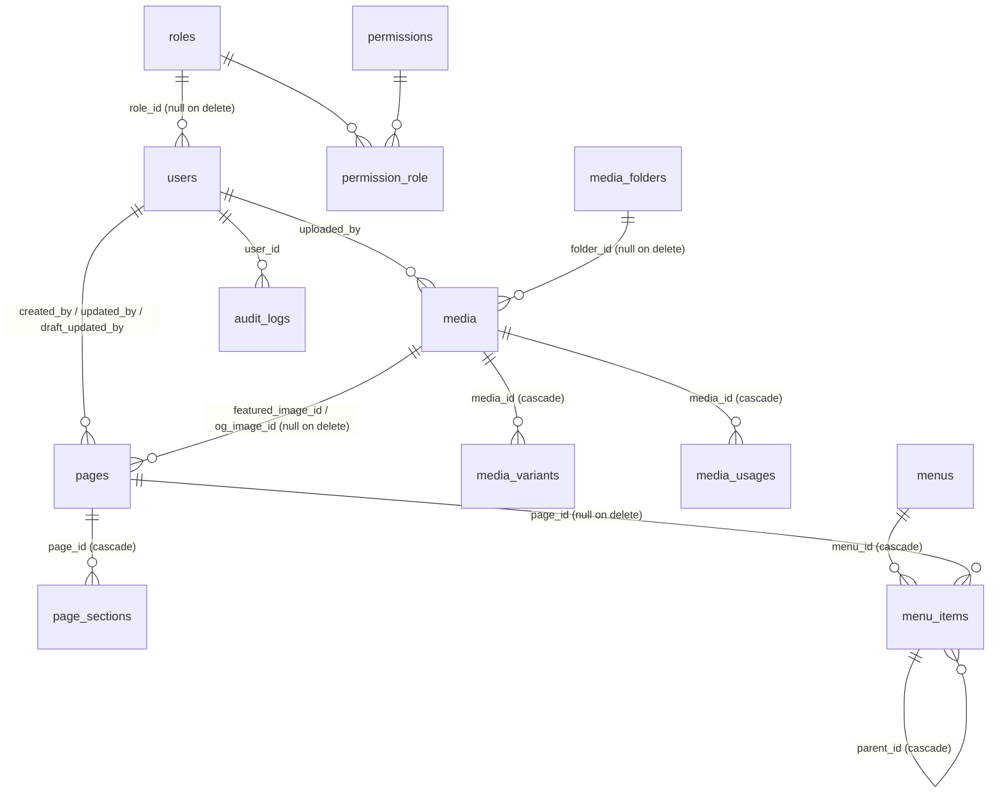

# Database design

All tables are created by Laravel migrations in `database/migrations`. They run on MySQL 8 / MariaDB 10.6+ (production) and on SQLite (tests).

| Table | Purpose | Notes |
|---|---|---|
| `users` | Admin accounts | `role_id`, `is_active`, `last_login_at/ip`; bcrypt passwords |
| `roles`, `permissions`, `permission_role` | Role-based access control | 3 system roles, 12 permissions (config/cms.php) |
| `pages` | One row per page | Unique `slug` (empty string = home); `status` draft/published plus `published_at` for scheduling; SEO columns (`meta_title`, `meta_description`, `canonical_url`, `robots`, `og_*`, `in_sitemap`); `draft` JSON holds pending changes to a published page; soft deletes (trash) |
| `page_sections` | Ordered content blocks of a page | `type` = section design key, `data` = JSON validated against that type's schema, `sort`, `is_enabled`, optional `anchor` |
| `media` | Media library items | Public optimised file `path`, private `original_path`, alt/title/caption, MIME, sizes, dimensions, `edits` (crop/rotate instructions), `optimization` report |
| `media_variants` | Responsive renditions | `w320 … w1920` WebP and `thumb`; unique (media, name, format) |
| `media_usages` | Where each media item is used | Rebuilt on every page/settings save; used to block deleting images that are in use |
| `media_folders` | Optional folders | |
| `menus`, `menu_items` | Header and footer menus | Items link to a page (`page_id`, plus optional `#fragment` in `url`) or a custom `url`; nesting via `parent_id`; `target`, `style`, `is_enabled`, `sort` |
| `settings` | Website-wide settings / global content | Key–value (JSON). The schema and defaults are in `config/cms.php`. |
| `redirects` | 301/302/307/308 redirects | Unique normalised `from_path`, `hits`, `last_hit_at` |
| `audit_logs` | Record of administrative actions | `action`, polymorphic subject, `description`, JSON `properties` (changed fields), IP, user agent |
| `form_submissions` | Enquiry and job-application forms | Structured columns for name/email/phone plus JSON `data`; CV path on the private disk |
| `sessions`, `cache`, `jobs`, `password_reset_tokens` | Laravel framework tables | |

### Why section data is JSON
Each page is an ordered list of rows, one per section. Every section type has its own field schema (`resources/cms/sections/<type>.json`). A row's JSON `data` is validated and sanitised against that schema whenever it is saved (`App\Cms\SectionData`). This gives structured, per-field editing without one database table per design. Page-level data (title, URL, status, SEO) lives in real columns, so it can be indexed and queried.

### Transactions
Multi-table operations run inside database transactions:
* page create/save/publish/duplicate/delete/restore
* menu save
* media upload/replace/edit/delete
* role matrix changes
* usage re-indexing
